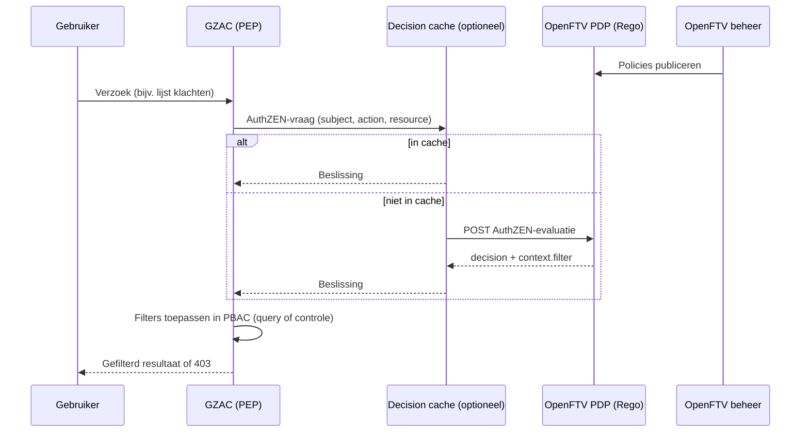
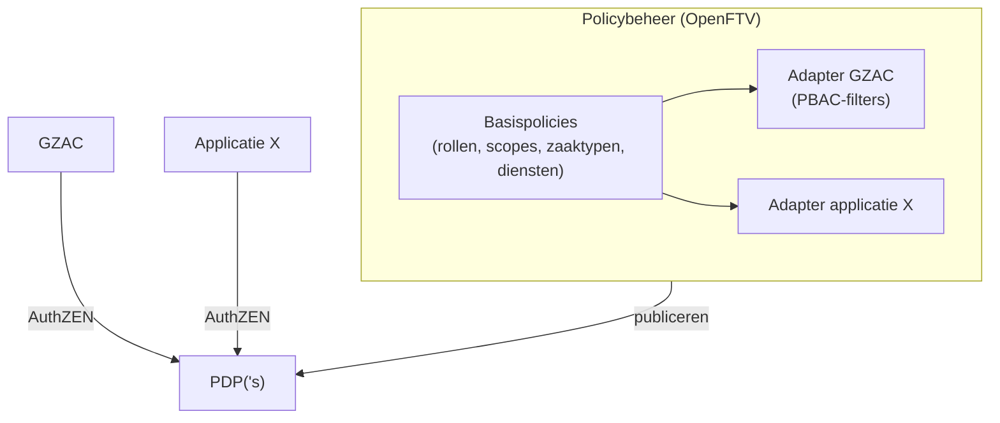

# Rapport: AuthZEN als autorisatielaag voor GZAC

## Samenvatting

In deze proof of concept (PoC) is de volledige autorisatie van GZAC (PBAC) vervangen door een externe Policy Decision Point (PDP) van OpenFTV, die GZAC bevraagt via de AuthZEN-standaard. De belangrijkste bevindingen:

- **Vervanging van PBAC:** dat werkt, met een kanttekening ("Ja, maar"). AuthZEN kan alle PBAC-vragen beantwoorden, maar de policies moeten antwoorden geven in de vorm die Valtimo verwacht. Daarvoor is kennis van de interne werking van Valtimo nodig.
- **Performance:** voldoende voor dagelijks gebruik. Zonder cache is een klachten-API-call gemiddeld 10 tot 100 ms trager dan met de standaard PBAC (ruim 2× zo traag), omdat elke PDP-call ±10 ms kost. Met de optionele decision cache is AuthZEN even snel als PBAC.
- **Beheer:** wijzigingen in policies zijn ongeveer één seconde na publicatie actief, zonder release of herstart van GZAC.
- **Gedeelde policies:** de huidige policies en AuthZEN-responses zijn specifiek voor GZAC. Om policies over meerdere applicaties te delen is een gemeenschappelijke response-definitie nodig. Daarvoor staat een voorstel in dit rapport.

## Doel

Dit project is voor FTV (Federatieve Toegangsverlening) uitgevoerd om een concrete use-case te hebben en te analyseren. Het moet de volgende vragen beantwoorden:

1. Is AuthZEN een vervanging voor PBAC in GZAC?
2. Wat is de impact op de performance van GZAC bij het gebruik van AuthZEN?
3. Wat zijn de voor- en nadelen van AuthZEN?
4. Hoe zet je een landschap van meerdere applicaties op dat gedeelde policies gebruikt via AuthZEN?

## Introductie

Een kort overzicht van de gebruikte technieken en applicaties.

### GZAC

GZAC is een generiek zaakafhandelcomponent, ontwikkeld door Ritense op basis van Valtimo, dat binnen Common Ground wordt gebruikt om zaken af te handelen. GZAC heeft een eigen autorisatiemodel: PBAC (Permission Based Access Control).

### AuthZEN

AuthZEN is een open standaard van de OpenID Foundation (AuthZEN Working Group). Hij definieert een neutrale API waarmee een applicatie (de Policy Enforcement Point, PEP) autorisatiebeslissingen opvraagt bij een externe PDP. Een vraag bestaat uit een `subject` (wie), `action` (wat), `resource` (waarop) en optioneel `context`. Het antwoord is een `decision` (true/false), eventueel met een `context` voor aanvullende informatie.

### OpenFTV

OpenFTV is een open-source referentie-implementatie van Federatieve Toegangsverlening voor de Nederlandse overheid. OpenFTV levert de PDP (gebaseerd op Open Policy Agent, policies in Rego), een beheeromgeving voor de policies en een decision log ("Logboek").

## Uitvoering

De repository https://github.com/nielserkamp-ritense/authzen bevat een demo van GZAC, OpenFTV en de Open*-componenten (Open Zaak, Objecten, Open Notificaties). GZAC gebruikt in deze demo uitsluitend de PDP van OpenFTV voor autorisatie.

De demo bevat drie processen, elk met een eigen policy:

| Proces | Gekoppeld aan zaaktype | Autorisatie op basis van |
|---|---|---|
| Klachten (Gemeente Den Haag) | Ja | Rol per afdeling (dienst), plus kandidaatgroep van de taak |
| Bezwaar | Ja | Rol (behandelaar, juridisch adviseur) en de status van het bezwaar |
| ToDo | Nee | Relatie van de gebruiker tot de ToDo (aanmaker of toegewezene) |

Klachten en bezwaar zijn processen die bij gemeenten voorkomen. Ze vragen om fijnmazige rechten, zodat een onbevoegde gebruiker niet bij de gegevens kan. ToDo is een eenvoudig ondersteunend proces zonder zaaktype, maar met beperkingen op wie wat mag zien en uitvoeren. Daarmee laat het zien dat ook autorisatie op basis van relaties (in plaats van rollen) mogelijk is.

Alle autorisatiebeslissingen lopen via de PDP en worden met Rego-regels geëvalueerd. Scripts in de repository (`scripts/klachten-authz-check.py`, `scripts/todo-authz-check.py`, `scripts/demo-seed.py --check`) controleren per gebruiker of de verwachte rechten gelden.

### Hoe werkt het?



#### Het "Ja, maar"-principe

PBAC stelt aan de PDP in de kern twee soorten vragen. Beide krijgen een antwoord in de vorm "Ja, maar": een beslissing **plus** filters die GZAC zelf nog moet toepassen.

| | 1) Mag ik deze actie uitvoeren? | 2) Welke resources mag ik zien? |
|---|---|---|
| Voorbeeld | Mag ik klacht X bekijken? | Toon de lijst met klachten |
| Vraag aan de PDP | `action`, specifieke `resource`, `subject` met rollen | `action`, resourcetype (`id: "*"`), `subject` |
| Antwoord | `decision` + eventuele filters | `decision` + lijst met filters |
| Wat GZAC ermee doet | Evalueert de filters op de resource om definitief te beslissen | Zet de filters om naar een query, zodat alleen toegestane resources worden getoond |

Het "maar" bestaat omdat de PDP niet alle gegevens van GZAC kent. Een voorbeeld: de PDP weet welke zaaktypen een rol mag zien, maar niet bij welk zaaktype een bepaald dossier hoort. Die laatste stap kan niet in AuthZEN of Rego worden uitgedrukt zonder de data naar de PDP te brengen. Daarom levert de PDP een filter mee, dat GZAC binnen PBAC evalueert.

#### Policy in OpenFTV

De PDP beslist op basis van Rego-policies die in OpenFTV worden beheerd. Een fragment uit de klachten-policy:

```rego
# Klachtenbehandelaar SZW: handles the complaints assigned to dienst SZW.
klachten_scopes["ROLE_KLACHTEN_KLACHTBEHANDELAAR_SZW"] := {
	"rights": "behandelaar",
	"diensten": ["SZW"],
}
```

Een rol krijgt hier een set rechten (`behandelaar`) en een scope (dienst `SZW`). De rest van de policy vertaalt dit naar de filters die PBAC verwacht.

#### AuthZEN-request

Een voorbeeld van een vraag van GZAC aan de PDP (type 2: welke dossiers mag deze gebruiker in de lijst zien?). De velden komen sterk overeen met wat PBAC zelf gebruikt voor een autorisatiecontrole.

```json
{
  "subject": {
    "type": "user",
    "id": "klachten-behandelaar-szw@example.com",
    "properties": {
      "username": "klachten-behandelaar-szw",
      "roles": ["ROLE_KLACHTEN_KLACHTBEHANDELAAR_SZW", "ROLE_USER", "..."],
      "teams": []
    }
  },
  "action": { "name": "view_list" },
  "resource": {
    "type": "com.ritense.document.domain.impl.JsonSchemaDocument",
    "id": "*"
  }
}
```

#### AuthZEN-response

De PDP antwoordt met `decision: true` en in `context.filter` een lijst met PBAC-permissies (ingekort):

```json
{
  "decision": true,
  "context": {
    "filter": [
      {
        "type": "ValtimoAuthorizationPermission",
        "resourceType": "com.ritense.document.domain.impl.JsonSchemaDocument",
        "actions": ["view", "view_list"],
        "role": "ROLE_BEZWAAR_ADVISEUR",
        "conditionContainer": {
          "conditions": [{
            "type": "container",
            "resourceType": "com.ritense.case_.domain.definition.CaseDefinition",
            "conditions": [{
              "type": "container",
              "resourceType": "com.ritense.zakenapi.domain.ZaakTypeLink",
              "conditions": [{
                "type": "field",
                "field": "zaakTypeUrl",
                "operator": "==",
                "value": "http://host.docker.internal:8001/catalogi/api/v1/zaaktypen/744ca059-..."
              }]
            }]
          }]
        }
      }
    ]
  }
}
```

Lees dit als: "Ja, je mag documenten bekijken, **maar** alleen documenten waarvan de case definition gekoppeld is aan dit zaaktype." De response bevat Valtimo-klassenamen (`com.ritense...`) en de interne structuur van PBAC-condities. Dat is de koppeling die bij vraag 1 en vraag 4 terugkomt.

## Discussie

### 1. Is AuthZEN een vervanging voor PBAC in GZAC?

**Ja, maar.** In deze demo is de volledige PBAC-laag van GZAC vervangen door calls naar een AuthZEN-PDP. Alle drie de processen, inclusief rol-, status- en relatiegebaseerde regels, werken zoals bedoeld. Dat is met scripts per gebruiker gecontroleerd.

De kanttekeningen:

- **Kennis van Valtimo is nodig.** De policies moeten filters opleveren die exact overeenkomen met de PBAC-permissies die Valtimo verwacht: klassenamen, veldnamen en de structuur van de condities. Een policy-schrijver zonder kennis van Valtimo kan dit niet zelfstandig.
- **Afhankelijk van de policy-taal.** De response wordt in Rego opgebouwd. Een andere PDP (met een andere policy-taal) moet dezelfde responsestructuur kunnen produceren.
- **Niet alles is te controleren.** Waar GZAC de benodigde gegevens niet heeft (bijv. de status van een bezwaar dat nog niet bestaat), kan ook de PDP er niet op beslissen.

### 2. Wat is de impact op de performance van GZAC?

**Merkbaar zonder cache, verwaarloosbaar met cache.** In de standaardsituatie haalt PBAC de permissies uit de database. Met AuthZEN wordt dat een HTTP-call naar de PDP. Draait de PDP dicht bij GZAC (dezelfde machine of hetzelfde cluster), dan is de extra netwerklatency klein, maar elke call telt op.

#### Snelheidsmeting klachten-API

De klachten-API-calls van GZAC zijn in drie varianten gemeten, op dezelfde stack en dezelfde data (28 klachten):

- **PBAC:** AuthZEN uit (`VALTIMO_AUTHORIZATION_AUTHZEN_ENABLED=false`), met de Valtimo-permissies (JSON) van vóór de overstap naar AuthZEN;
- **AuthZEN:** zonder cache, de standaard van de demo;
- **AuthZEN + cache:** met de decision cache aan (TTL 60 s).

Per variant is GZAC herstart. Per gebruiker zijn eerst 5 warming-up-rondes gedaan en daarna 30 rondes langs alle calls, achter elkaar (geen gelijktijdige gebruikers). De tabel toont de mediaan in ms, gemiddeld over `admin`, `klachten-ibpost`, `klachten-behandelaar-szw` en `klachten-coordinator`:

| Call | PDP-calls | PBAC | AuthZEN | AuthZEN + cache |
|---|---|---|---|---|
| Zaaklijst (`POST /api/v1/case/{case}/search`) | 3 | 32 | 60 | 31 |
| Takenlijst (`POST /api/v3/task`) | 1 | 24 | 32 | 22 |
| Klacht openen (`GET /api/v1/document/{id}`) | 1 | 7 | 18 | 7 |
| Notities | 1 | 7 | 18 | 7 |
| Zaakdocumenten (`GET /api/v2/zaken-api/document/{id}/files`) | 10 | 51 | 151 | 46 |
| Widget | 2 | 11 | 31 | 11 |
| Taak openen (`GET /api/v1/task/{id}`) | 2 | 17 | 42 | 19 |
| **Totaal** | 20 | **149** | **352** | **143** |

- **Elke PDP-call kost ±10 ms.** De extra tijd zonder cache is vrijwel precies het aantal PDP-calls × 10 ms. GZAC stelt de vragen na elkaar, ook bij één verzoek met meerdere calls. Zaakdocumenten doet er 10 (één per document), dus deze call wordt het meest trager (+100 ms).
- **Met cache is AuthZEN even snel als PBAC.** Na de eerste call gaan er geen vragen meer naar de PDP. Het verschil met PBAC valt binnen de meetruis.
- **Voor een gebruiker** is een scherm met een paar calls zonder cache ±0,1 tot 0,2 s trager. Dat is merkbaar maar acceptabel. Bij een PDP op afstand (bijv. 30 ms per call) loopt dit snel op: zaakdocumenten zou dan ±0,3 s langer duren.
- **Kanttekening bij de vergelijking:** de oude PBAC-permissies wijken op een paar punten af van de policies (KCC mag de klacht en de zaakdocumenten niet openen, de SZW-behandelaar ziet meer taken). Daarom telt `klachten-kcc` niet mee in de tabel. De gemeten calls gaven bij de andere gebruikers hetzelfde resultaat.

#### Demo-controle

GZAC kan de antwoorden van de PDP optioneel cachen (`./run.sh --cache`, standaard **uit**, TTL standaard 60 s). Lokaal gemeten met `scripts/demo-seed.py --check`, twee keer achter elkaar uitgevoerd:

| | PDP-calls, 1e run | PDP-calls, 2e run | Tijd per run |
|---|---|---|---|
| Cache uit | 61 | 61 | ±5 s |
| Cache aan | 29 | 4 | ±4 s |

Opmerkingen bij deze meting:

- De PDP draait in deze opstelling op dezelfde machine. De tijdwinst van de cache is daarom klein. De besparing in calls is vooral van belang als de PDP op afstand draait of zwaar belast is.
- De cache heeft een prijs: een policy-wijziging is pas actief als de gecachte antwoorden verlopen zijn. In de demo duurde dat 26 seconden in plaats van een halve seconde.
- Beide metingen zijn geen belastingtest. Een meting onder realistische belasting (meerdere gelijktijdige gebruikers, PDP op afstand) is nog nodig voor een definitief oordeel.
- Is de PDP onbereikbaar, dan wordt alles geweigerd, ook voor beheerders, en wacht elk verzoek eerst op de timeout (±3 s). De beschikbaarheid van de PDP wordt daarmee een voorwaarde voor de beschikbaarheid van GZAC.

#### Waarom kost een PDP-call ±10 ms?

Het ligt niet aan de hoeveelheid calls. Het is vast werk dat de PDP bij elke vraag doet. Gemeten met dezelfde request die GZAC stuurt, rechtstreeks naar de PDP:

| Meting | Resultaat |
|---|---|
| Eén call naar de PDP | ±9 ms, waarvan 0,08 ms voor de verbinding |
| 100 calls direct achter elkaar | mediaan 9,2 ms |
| 15 calls met 0,5 s ertussen | mediaan 15 ms (trager, dus geen effect van belasting) |
| Call met een leeg antwoord (weigering, 42 bytes) | toch 6 ms |
| Alleen de Rego-evaluatie (`opa eval`, dezelfde policies) | gemiddeld ±3 ms, maximaal ±4,6 ms |
| Decision log | niet in het pad van het verzoek: OpenFTV schrijft het in batches weg |

De ±10 ms per call bestaat uit:

1. **Evaluatie van de policy (±3–5 ms).** De policies berekenen de permissies van alle rollen, niet alleen die van de gebruiker. Voor één vraag van `klachten-kcc` wordt de controle op het resourcetype 609 keer uitgevoerd, en elke klachten-filterregel 336 keer. Het antwoord bevat 22 permissies voor 18 rollen (19 KB). GZAC gooit daarna alles weg wat niet bij de rollen van de gebruiker hoort.
2. **Vaste overhead van de PDP (±4–6 ms).** Het omzetten van de AuthZEN-request naar de OPA-input, de OpenTelemetry-span voor het decision log en het opbouwen van het JSON-antwoord. Daarom kost ook een leeg antwoord 6 ms.
3. **GZAC (±1 ms).** Netwerk en het inlezen van het grote antwoord.

GZAC stelt de vragen na elkaar, dus de tijd telt op: zaakdocumenten stelt er 10 en wordt ±100 ms trager.

Mogelijke verbeteringen (nog niet getest):

- **Alleen de rollen van de gebruiker evalueren.** Een controle op de rol (`has_role(role)`) in de `filter`-regels verkleint zowel het rekenwerk als het antwoord.
- **Vragen bundelen.** OpenFTV heeft een batch-endpoint (`/authzen/v1/evaluations`). Als de 10 vragen van zaakdocumenten in één request gaan, wordt de vaste overhead één keer betaald in plaats van tien keer. Nog uit te zoeken is waarom GZAC ze hier los stelt.
- **De decision cache aanzetten.** Dan is AuthZEN even snel als PBAC (zie de meting hierboven), met als prijs dat policy-wijzigingen later actief worden.
- **Verbetering van de PDP.** Optimalistaties aanbrengen in de PDP zelf, aangezien een empty call nog steeds 6ms is. 
- **Verbtering in Rego eval.** De Rego eval zou verbeterd kunnen worden er worden veel dynamische tabellen gemaakt die impact hebben op de eval.

### 3. Wat zijn de voor- en nadelen van AuthZEN?

**Voordelen**

- **Rijk genoeg voor PBAC.** Met het "Ja, maar"-principe (beslissing plus filters in `context`) kan AuthZEN een uitgebreid permissiesysteem als PBAC ondersteunen.
- **Open standaard, vrije keuze van PDP.** AuthZEN wordt ondersteund door meerdere leveranciers van policy engines. De organisatie kiest zelf welke policy-taal en welk beheersysteem ze gebruikt.
- **Centraal beheer, snel effect.** Policies worden buiten de applicatie beheerd en zijn ongeveer een seconde na publicatie actief, zonder release of herstart.
- **Inzicht en audit.** De PDP logt elke beslissing (het decision log in OpenFTV). Zo is achteraf na te gaan wie waartoe toegang kreeg en waarom.

**Nadelen**

- **Geen drop-in vervanging.** Een applicatie moet actief bepalen welke vragen ze aan de PDP stelt en hoe ze de antwoorden verwerkt.
- **Koppeling via de response.** De inhoud van `context` is niet gestandaardiseerd. In deze PoC bevat hij Valtimo-specifieke structuren, waardoor policies en applicatie sterk aan elkaar gekoppeld zijn.
- **Extra afhankelijkheid.** De PDP is een kritieke component. Uitval betekent dat niemand meer toegang heeft.
- **Afweging tussen actualiteit en performance.** Cachen vermindert het aantal calls, maar vertraagt het effect van policy-wijzigingen.

### 4. Hoe zet je een landschap van meerdere applicaties op met gedeelde policies?

Het knelpunt is dat de huidige policies, en daarmee de AuthZEN-responses, specifiek voor GZAC zijn gemaakt. Een andere applicatie kan weinig met een `ValtimoAuthorizationPermission` met Valtimo-klassenamen. Om policies te delen is een gemeenschappelijke taal nodig voor zowel de vraag als het "maar".

#### Voorstel voor een opzet binnen Common Ground

Dit is een voorstel. Het is in deze PoC niet uitgewerkt of getest.



1. **Gemeenschappelijk vocabulaire.** Leg vast welke `subject`-, `action`- en `resource`-typen binnen Common Ground worden gebruikt, gebaseerd op begrippen uit de ZGW-API's (zaak, zaaktype, document, informatieobjecttype, vertrouwelijkheidaanduiding) in plaats van applicatie-interne klassenamen.
2. **Gestandaardiseerde "Ja, maar"-response.** Definieer een Common Ground-profiel voor `context`: een applicatie-neutraal filterformaat (bijv. "zaaktype in [...]", "dienst in [...]", "vertrouwelijkheid ≤ ..."). Een applicatie zet dit om naar haar eigen mechanisme. Voor GZAC is dat PBAC.
3. **Basispolicies plus applicatie-adapters.** Organisatiebrede regels (welke rol mag welke zaaktypen en diensten) staan één keer in een gedeelde policy. Applicatiespecifieke regels en vertalingen staan in een aparte module per applicatie, die op de basispolicy voortbouwt.
4. **Uitrol van de PDP.** Kies tussen één centrale PDP (eenvoudig beheer, maar netwerklatency en een single point of failure) en een PDP per applicatie of als sidecar met dezelfde gepubliceerde policies (lage latency, hogere beschikbaarheid). Gezien de bevindingen bij vraag 2 ligt een PDP dicht bij de applicatie voor de hand, met centraal beheer van de policies.
5. **Gedeelde testset.** Leg verwachte beslissingen per rol vast in een testset (zoals de check-scripts in deze PoC), zodat een policy-wijziging voor alle applicaties wordt gecontroleerd.

## Conclusie

De PoC laat zien dat AuthZEN met een OpenFTV-PDP de volledige PBAC-laag van GZAC kan vervangen. De performance lijkt voldoende voor dagelijks gebruik: zonder cache kost elke PDP-call ±10 ms extra, met de optionele decision cache is AuthZEN even snel als PBAC. Policies zijn centraal te beheren en wijzigingen zijn direct actief.

De belangrijkste open vraag is hoe policies over meerdere applicaties gedeeld kunnen worden. De huidige responses zijn sterk gekoppeld aan de interne structuur van Valtimo. Zonder een gemeenschappelijke response-definitie blijft het delen van policies beperkt. AuthZEN is daarmee een kansrijke richting voor de toekomst, op voorwaarde dat zo'n standaard er komt.

## Aanbevelingen en vervolgstappen

1. **Belastingtest** met een PDP op afstand en meerdere gelijktijdige gebruikers, met en zonder cache.
2. **Beschikbaarheid uitwerken:** een PDP dicht bij de applicatie en het gedrag bij uitval van de PDP (timeout, fallback).
3. **Common Ground-profiel voor AuthZEN** opstellen (vocabulaire en "Ja, maar"-responseformaat) in overleg met FTV en andere leveranciers.
4. **Tweede applicatie aansluiten** op dezelfde basispolicies, om het delen van policies in de praktijk te toetsen.
5. **Cache-invalidatie bij publicatie** onderzoeken, zodat cachen en direct effect van policy-wijzigingen samengaan.
